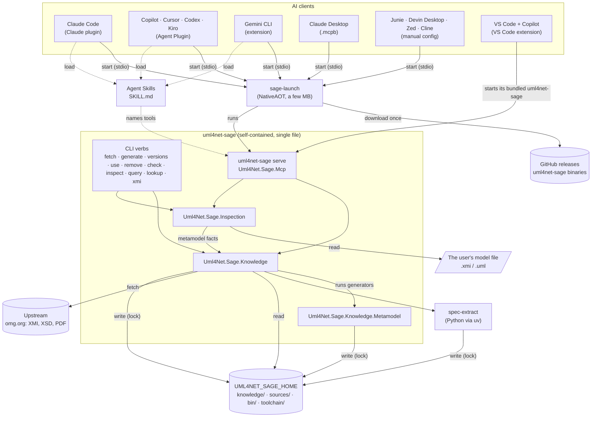
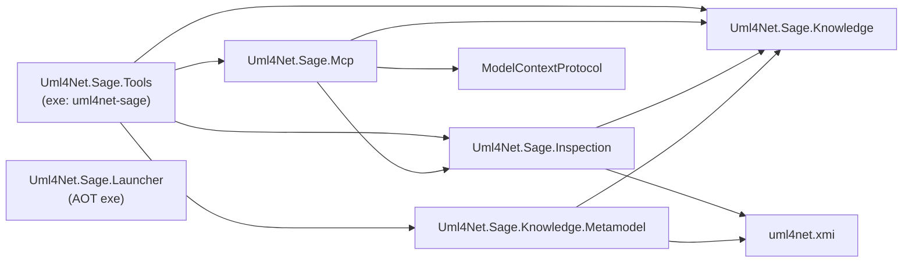

# uml4net-sage as an MCP server

Goal: one implementation of Sage for every AI client (Claude Code, GitHub Copilot, Cursor, Codex,
Gemini CLI, Claude Desktop, ...), exposed in one way: an MCP server, as mycelium-hypha does since its
tools 2.0.0 / plugin 3.0.0.

Reference: `mycelium-hypha` on `development` (commit `b150219`). Its own plan,
`hypha-mcp-refactor-plan.md`, was removed once done; read it with
`git show 9309280^:hypha-mcp-refactor-plan.md` in that repository. This file takes its target
architecture and says where Sage differs, but not its ten steps: with the target known, Sage gets
there in six phases (section 3). Section 2.9 lists, item by item, what "on par with hypha" means.

Unchanged decision: all knowledge is generated on the user's machine from OMG's own files. Nothing
generated is distributed (see `CLAUDE.md`, "Committed vs git-ignored").

---

## 1. Where Sage is today, and where hypha is now

| Concern | Sage today (plugin 1.6.0) | hypha now | Sage after this plan |
| --- | --- | --- | --- |
| How a client reaches the knowledge | Skills read `knowledge/` files in the plugin folder, run `jq`, and shell out to `uml4net-sage` | MCP tools only | MCP tools only |
| Session start | NativeAOT SessionStart hook (`hooks/native/`, bash dispatch in `plugin.json`) downloads the CLI and runs `check --json` | No hook; a NativeAOT launcher (`bin/hypha-launch`) downloads `hypha` and runs `hypha serve` | No hook; `bin/sage-launch` runs `uml4net-sage serve` |
| Where knowledge lives | The plugin folder (`CLAUDE_PLUGIN_ROOT`), else the working directory (`RepositoryRootResolver`) | One per-user folder, `HYPHA_HOME`, shared by every client | One per-user folder, `UML4NET_SAGE_HOME` |
| Query logic | None in C#: `jq` examples in skills and agents; `MetamodelFacts` reads a subset for `inspect` | `IKnowledgeQuery` in `Hypha.Knowledge.Query`, used by CLI verbs and MCP tools alike | The same, as `Uml4Net.Sage.Knowledge.Query` |
| Agents | 4 (`metamodel-navigator`, `uml-spec-citation`, `xmi-spec-citation`, `uml-xmi-inspector`) | None; a fan-out question is one query call | None |
| Clients | Claude Code only | Claude Code, Agent Plugins clients, Gemini CLI, Claude Desktop, manual-config clients, a VS Code extension | The same, VS Code extension included |
| Project direction | `Uml4Net.Sage.Knowledge` references `Uml4Net.Sage.MetamodelGen` | `Hypha.Knowledge.Metamodel` references `Hypha.Knowledge`, never the reverse | Reversed, as hypha |
| JSON | Reflection-based `System.Text.Json`, types in `MetamodelGen/Model`, no schema version, PascalCase `--json` | Source-generated `JsonSerializerContext` per artifact next to its types in the knowledge library, a `schemaVersion` on each, camelCase | As hypha |
| Element to clause | None: the skill has the model guess the clause | `cross-references.json`, generated | Generated, by clause title |
| Composition | No options class, DI registration or `ILogger` in the libraries | An options class, one DI registration per library, `ILogger` | As hypha |
| Repository | No CHANGELOG, RELEASING, CONTRIBUTING, dependabot, SonarCloud or wiki | All of them | As hypha |
| CLI platforms | win-x64, linux-x64, osx-x64, osx-arm64 (hook: three of them) | Those plus linux-arm64, for the CLI and the launcher | As hypha |

What Sage has that hypha does not, and must keep working over MCP:

- **`inspect`**: checking a user's own XMI file (with `--pathmap`). It is the one tool that reads a file
  outside the knowledge folder.
- **The Standard Profile** (`standard-profile/`), and the metamodel's **association** pages.
- **The XMI specification as a second version line** (`knowledge/xmi/<version>/`, `sources/xmi/<version>/schema/*.xsd`).
  It plays the role hypha's Systems Modeling API axis plays.
- **`datapackage.json`**: stays as it is; no tool reads through it.

What hypha has that Sage does not need:

- **Upstream discovery** (`hypha_check_releases`, GitHub tags, the rate-limit notices): Sage's versions
  are a static registry compiled into the CLI (`KnownUmlVersions`, `KnownXmiVersions`) and fetched from
  fixed omg.org addresses. A new UML version reaches users through a new tools release.
- **`hypha_diff`**: there is one UML version. Add it when a second one is registered.
- **Textual notation, model library, worked examples, `move-window`**: no UML counterpart.

---

## 2. Target architecture

### 2.1 Principles (hypha's ten, unchanged)

1. **One binary**: a single self-contained `uml4net-sage` per platform, holding the CLI verbs and the
   MCP server (`uml4net-sage serve`). Writes run in-process.
2. **One interface for AI clients**: the MCP server. No client reads the files, runs `jq` or the CLI.
3. **Two portable layers**: the server holds the capability (tools, resources, prompts); Agent Skills
   hold the procedure and call MCP tools only, by their bare names.
4. **Read and write separated by namespace** inside one `Uml4Net.Sage.Knowledge` library. Reading code
   makes no network calls and never calls the write path.
5. **Safe concurrent writers**: every client starts its own server, so installs, switches and removals
   take one cross-process lock, files are written to a temporary file and renamed, and readers notice
   changes made by another process.
6. **One knowledge location** per user, shared by every client.
7. **Shared contracts**: a generator and the code that reads its output use the same C# types.
8. **Clients are packaging only**: every manifest points at the same `skills/` and the same launcher.
9. **Tools first**: every capability works through tools plus the server's `instructions`, because some
   clients load no skills, resources or prompts.
10. **Local only**: stdio on the user's machine. Web-only clients are out of scope.

The NativeAOT question is already settled in `CLAUDE.md`: the full CLI is not AOT-friendly
(`uml4net.xmi`, Spectre.Console, System.CommandLine). Only the launcher is NativeAOT, as only the hook
is today.

### 2.2 Components

| Component | Kind | Role | Comes from |
| --- | --- | --- | --- |
| `Uml4Net.Sage.Knowledge` (`tools/knowledge-gen`) | Library | Reading: layout, installed versions, contracts and typed readers, query API, lookup, search, addressing, grounding. Writing: fetch, generator orchestration, the specification and cross-reference generators, install / use / remove, the lock | Exists; gains the read side |
| `Uml4Net.Sage.Knowledge.Metamodel` (`tools/metamodel-gen`) | Library | XMI to `metamodel/` and `standard-profile/`, with uml4net | `Uml4Net.Sage.MetamodelGen`, renamed |
| `Uml4Net.Sage.Inspection` (`tools/inspection`) | Library | `XmiInspector`, `XmiDocumentScanner`, `MetamodelFacts`, findings | Moved out of `Uml4Net.Sage.Tools/Inspection` |
| `Uml4Net.Sage.Mcp` (`tools/sage-mcp`) | Library | MCP tools, resources, prompts, `instructions` | New |
| `Uml4Net.Sage.Tools` (`tools/sage-cli`) | Executable `uml4net-sage` | CLI verbs and `serve` | Exists; gains `serve`, `query`, `lookup` and the `xmi` verbs; also packed as a .NET tool |
| `Uml4Net.Sage.Launcher` (`tools/sage-launcher`) | Executable `sage-launch`, NativeAOT | Downloads the matching `uml4net-sage` once, then runs `uml4net-sage serve` | `Uml4Net.Sage.Tools.Hook`'s `CliProvisioner`, `ChecksumTable`, `CacheLayout`, `GitHubRelease`, `RuntimeIdentifier` |
| `tools/spec-extract` | Python | PDF to clause text, run through `uv` | Exists; also embedded in the knowledge library (Phase 1) |
| `skills/` | Markdown | Grounding discipline, when to cite or reason | Rewritten over the tools |
| `extensions/vscode` | VS Code extension (TypeScript) | Bundles `uml4net-sage` and registers its `serve` as an MCP server definition provider for Copilot. No tools, commands or storage of its own; the server reads the home folder like every other client | New, ported from hypha's `extensions/vscode` |

Retired: `Uml4Net.Sage.Tools.Hook`, `hooks/native/`, `agents/`, `jq`, the `sageCliVersion` field and
the `hooks` block of `.claude-plugin/plugin.json`, `RepositoryRootResolver`'s `CLAUDE_PLUGIN_ROOT`
branch, and the Git Bash requirement on Windows that the hook's dispatch brings.

### 2.3 Component diagram

How the AI clients reach Sage. This is the diagram on the hypha wiki's Architecture page, with Sage's
names, omg.org as the only upstream, and the user's own model file as an input of
`uml4net_sage_inspect`.



Reading it:

- Every client but the VS Code extension starts the same launcher over stdio. The launcher downloads
  the matching `uml4net-sage` once and then only passes messages through to `uml4net-sage serve`. The
  extension carries its own `uml4net-sage` and starts `serve` directly.
- Skills are optional and hold no capability: they name tools. A client that loads none (Claude
  Desktop) still has every tool, and the server's `instructions`.
- The server and the CLI verbs sit on the same libraries, so a tool and its verb give the same answer.
- Only `Uml4Net.Sage.Knowledge` reads the home folder and fetches from omg.org; it, the generators it
  runs and the extractor write there, under one lock. Only `Uml4Net.Sage.Inspection` reads a file of
  the user's.

### 2.4 Project dependencies

Which project references which, after the change. The one difference from hypha is
`Uml4Net.Sage.Inspection`; today the arrow between the first two runs the other way.



`Uml4Net.Sage.Knowledge` references nothing in the repository and not uml4net. `Uml4Net.Sage.Launcher`
references nothing in the repository either.

### 2.5 Data: `UML4NET_SAGE_HOME`

One per-user folder: `uml4net-sage` under the per-user local application data folder, overridable
with `UML4NET_SAGE_HOME`, which must be an absolute path. The launcher and the knowledge library
each resolve it, by the same rule, and a test holds them together.

```
UML4NET_SAGE_HOME/
├── knowledge/
│   ├── installed.json           installed UML versions and XMI specification versions, a default for each
│   ├── <version>/               metamodel/, standard-profile/, spec/, cross-references.json, datapackage.json
│   └── xmi/<version>/           spec/, datapackage.json
├── sources/                     fetched from omg.org: <version>/, xmi/<version>/schema/*.xsd
├── bin/<version>/<rid>/         uml4net-sage binaries the launcher downloaded, each with an .ok marker
├── state/<install key>/         the launcher's download-error.log, per plugin install
├── toolchain/                   uv, its cache, a managed Python, and the unpacked spec-extract project
├── .release-operation.lock      held during an install, use or remove
└── .release-operation.lock.recovery
```

Where the CLI looks, first match wins (hypha's order): `--repository-root`; a source checkout above
the working directory (not for `serve`, whose working directory the client chooses); the `Home`
option; `UML4NET_SAGE_HOME`; a source checkout above the running assembly; the default folder. A
source checkout is a folder holding `sources/`, `knowledge/` and `uml4net-sage.slnx`: the two
folders alone may be a user's own project. `knowledge/registry.json` and the schemas stay committed;
the server answers "what versions exist" from `KnownUmlVersions`, not from that file.

**Schema versions.** Every generated JSON document and `installed.json` carries a top-level
`schemaVersion`, a constant next to its type, as in hypha. Sage 1.x writes none. The inventory
reports an artifact whose `schemaVersion` is not the current one as not generated, with the reason,
so that a later change of format shows up as "install again" and never as a wrong answer.

**No migration.** What plugin 1.x generated in its own folder is not copied: it has no
`schemaVersion` and its format changes in Phases 1 and 2, so hypha's migration, which copies only
knowledge in the current format, would copy nothing. The first session finds nothing installed, says
so, and offers an install. The 1.x leftovers in the default folder (the hook's CLI cache per plugin
checkout, the old `uv` cache) are not read; the CHANGELOG says they can be deleted.

### 2.6 The MCP server

Official `ModelContextProtocol` C# SDK (hypha pins 2.4.0), stdio, tool, resource and prompt types
registered explicitly (`WithTools<T>()` and so on), logging to standard error only. `serverInfo`:
name `sage`, a title naming UML 2.5.1 and XMI, and the version from the assembly's informational
version.

**Tools**, all prefixed `uml4net_sage_` on a server named `sage`, each with `ReadOnly` /
`Idempotent` / `OpenWorld` / `Destructive` set, and related questions grouped behind a `question`
argument whose values are the `uml4net-sage query` verb names. Seventeen, as hypha has, and under
twenty. What follows the prefix is at most 20 characters, so that Claude Code's full name
(`mcp__plugin_uml4net-sage_sage__uml4net_sage_install_version`, 59 characters) stays within 64.

This table is the contract. `version` is always optional and means the default of the axis.

| Tool | `question` values | Other arguments |
| --- | --- | --- |
| `uml4net_sage_metaclass` | `element`, `ancestors`, `subclasses`, `specializes`, `neighbours`, `constraints`, `operations`, `literals`, `features`, `effective-features`, `clauses` | `name` (required), `general`, `feature`, `concreteOnly` (false), `includeInherited` (true), `version` |
| `uml4net_sage_feature` | `redefinitions`, `subsettings`, `opposite`, `feature-constraints`, `contributors` | `feature` (required), `class`, `version` |
| `uml4net_sage_typed_by` | `classes-with-feature-typed`, `features-accepting`, `containers` | `type` (required), `class`, `compositeOnly` (false), `version` |
| `uml4net_sage_package` | none | `name` (required), `version` |
| `uml4net_sage_association` | `association`, `associations-of` | `name` (required: an association, or a class for `associations-of`), `version` |
| `uml4net_sage_stereotype` | `stereotype`, `applicable-to`, `stereotypes` | `name`, `metaclass`, `version` |
| `uml4net_sage_spec` | `clause`, `elements-in-clause` | `document` (required: `uml` or `xmi`), `clause` (required), `includeSubclauses` (false), `version` |
| `uml4net_sage_xmi_schema` | `schema-element`, `complex-type`, `attribute-group`, `schema-contents` | `name`, `schema` (`xmi` or `canonical`), `version` |
| `uml4net_sage_search` | none | `text` (required), `kind` (`metamodel`, `standard-profile`, `uml`, `xmi`), `limit` (20, at most 200), `version` |
| `uml4net_sage_search_spec` | none | `text` (required), `document`, `limit` (20, at most 200), `version` |
| `uml4net_sage_resolve` | none | `address` (required) |
| `uml4net_sage_lookup` | none | `kind` (required: `metamodel` or `standard-profile`), `name` (required), `startLine`, `maxLines` (160, at most 2000), `version` |
| `uml4net_sage_inspect` | none | `path` (required, absolute), `pathmaps`, `severity`, `category`, `offset`, `limit` (50), `version` |
| `uml4net_sage_version_status` | none | none |
| `uml4net_sage_install_version` | none | `version`, `axis` (`uml`, the default, or `xmi`), `includeSpecifications` (true), `makeDefault` (true) |
| `uml4net_sage_use_version` | none | `version` (required), `axis` |
| `uml4net_sage_remove_version` | none | `version` (required), `force` (false), `axis` |

What each replaces: the metamodel tools replace `metamodel-lookup`'s read order, the `jq` examples
and the `metamodel-navigator` agent; `uml4net_sage_stereotype` replaces `standard-profile-lookup`'s
file reads; `uml4net_sage_spec` and `uml4net_sage_search_spec` replace both citation skills' file
reads and both citation agents; `uml4net_sage_xmi_schema` replaces the skill's reading of raw XSD;
`uml4net_sage_inspect` replaces `uml4net-sage inspect --json` and the `uml-xmi-inspector` agent; the
version tools replace `check`, `versions`, `fetch`, `generate`, `use` and `remove` command lines.

Rules common to every tool, all as in hypha:

- **Answers** are one JSON document as text, in camelCase, the same document the matching
  `uml4net-sage query --json` verb prints. A query answer is `{value, grounding: {tier, version,
  source}, unavailable?}`. No structured output and no output schema.
- **Annotations.** Read tools: read-only, idempotent, not destructive, closed world.
  `uml4net_sage_install_version`: not read-only, idempotent, open world (it fetches from omg.org).
  `uml4net_sage_use_version`: not read-only, idempotent. `uml4net_sage_remove_version`: destructive,
  not idempotent.
- **Refusals** (a version that is not installed, removing the default without `force`, a question
  that needs an argument it was not given, a relative `path`) come back as the tool error itself,
  with a message that says what to do, and are logged at information level; a failure (a file that
  cannot be read, omg.org out of reach) is a warning with its exception.
- **`unavailable`** is set, with the reason, when an optional artifact was never generated (the
  specification text, and the cross-references that need it). A missing core artifact is a refusal.
- **Progress** for an install is sent as progress notifications when the call carries a token.
- **The `axis` argument** is hypha's (`release` / `api` there): the same three tools manage both
  version lines without adding to the count. The XMI axis holds the XMI specification text and its
  two XSD files; the UML metamodel's own `.xmi` files belong to the UML axis.

Notes on the tools that have no hypha counterpart:

- `uml4net_sage_inspect` is read-only but reads outside the home folder. It requires an absolute
  path (the server's working directory is the client's choice), refuses anything that is not a file,
  and returns the counts per severity and category with one page of findings, so a report of
  thousands of findings does not flood the context. That paging replaces the `uml-xmi-inspector`
  agent. It needs the metamodel of `version` installed.
- `uml4net_sage_xmi_schema` needs a small typed reader over the two XSD files, which today only the
  skill interprets. It reads `sources/xmi/<version>/schema/`, so the read side resolves `sources/`
  as well as `knowledge/`.
- `uml4net_sage_association` and `uml4net_sage_stereotype` answer from `metamodel.json` and the
  Standard Profile index as the metamodel tools do.

**Cross-references.** hypha answers "which clause treats this element" and "which elements does
this clause treat" from a generated `cross-references.json`. Sage gets the same artifact, for the
UML specification: element to clause **identifier**, never clause text, each edge with the method
that produced it and the tier DERIVED. UML 2.5.1 has one "Classifier Descriptions" subclause per
metaclass, so the method is a match of the clause title on the metaclass name (`clause-title`); a
name with no such clause has no edge. It is read by `uml4net_sage_metaclass` `clauses` and
`uml4net_sage_spec` `elements-in-clause`, and is `unavailable` while the specification text is.

**Resources**: one template, `sage://{version}/{kind}/{name}`, named `sage_page`, `text/markdown`,
over the generated pages; `kind` is `metamodel`, `standard-profile`, `uml` or `xmi` (a clause of
that document, with the XMI version as `version`). No resource list. Every address in an answer
carries its `uri`, and everything is also reachable through a tool.

**Prompts**: `overview` (no argument), `explain_metaclass(name)`, `cite_specification(topic)`,
`inspect_model(path)`, `explain_stereotype(name)`. A prompt called without a required argument is
refused by name.

**`instructions`**, enough on their own for a client that loads no skills (Claude Desktop): what
Sage covers (UML 2.5.1 and XMI 2.5.1, not SysML v2); the NORMATIVE / MODEL / DERIVED tiers and
`unavailable`; first use (nothing installed: say so, offer `uml4net_sage_install_version` for both
axes, do not answer from memory); which tool when, naming all seventeen and no other; how to answer
(one call per element, never collect a closure by hand, what a missing specification text means,
never invent a quote); changing versions (confirm an install or a removal, the `xmi` axis, the
lock); the resource template; the default version.

### 2.7 The launcher (`sage-launch`)

A port of `tools/hypha-launcher`, with the names changed:

- `bin/sage-launch.exe` for Windows; a POSIX `bin/sage-launch` script that execs
  `bin/<rid>/sage-launch` on macOS and Linux. Every manifest names the one extensionless path.
- `bin/sage-launch.json` names the `uml4net-sage` version to start; the launcher finds it in its own
  folder or up to two folders above. It downloads `uml4net-sage-<version>-<rid>.zip` from the
  `tools-v<version>` GitHub release, checks it against the `| asset | SHA256 |` table in the release
  body, keeps it in `bin/<version>/<rid>/` under the home folder, and runs `uml4net-sage serve` on
  the same standard input and output, passing on its arguments and its exit code.
- Two clients starting at once: each download goes into a staging folder of its own and is renamed
  into place once verified. There is no lock; staging folders abandoned for an hour are removed.
- The first start answers the client at once, downloads meanwhile, then starts `uml4net-sage serve`,
  replays the client's `initialize` to it and tells the client that its tools, resources and prompts
  changed. Calls made meanwhile are not queued: only `uml4net_sage_status` answers. The session
  keeps the `instructions` it was given at `initialize` until the client reconnects, so the
  launcher's own instructions must already say what Sage is.
- When there is nothing to start, it serves one tool, `uml4net_sage_status`, that says why and how
  to fix it: `UML4NET_SAGE_BIN` relative or missing, no manifest, an unusable home folder, a release
  without the asset or its checksum, a checksum mismatch, an archive without the executable, a
  download that failed, an executable that cannot be started.
- `UML4NET_SAGE_BIN` names a pre-installed `uml4net-sage` (absolute path) for offline machines; the
  download honours `HTTPS_PROXY` and `GITHUB_TOKEN` (or `GH_TOKEN`).
- It resolves its own location and the home folder itself, never from a client's path variables.
- NativeAOT, invariant globalization, no project references.

### 2.8 Packaging

```
uml4net-sage/
├── manifest.source.json         name, description, package version, sageVersion, server command
├── plugin.json                  Agent Plugins 1.0 manifest
├── mcp.json                     Agent Plugins MCP config: ./bin/sage-launch
├── .claude-plugin/
│   ├── plugin.json              Claude Code: mcpServers, no hooks
│   └── marketplace.json         its source.ref set to the package version's tag
├── gemini-extension.json        Gemini CLI
├── packaging/mcpb/manifest.json Claude Desktop bundle (bin/ packed as server/)
├── skills/
├── commands/overview.md
├── docs/other-clients.md        Junie, Devin Desktop, Zed, Cline: a snippet each, where to copy skills
├── extensions/vscode/           the VS Code extension: package.json, src/, scripts/, host tests, icon.png
├── bin/                         the committed launchers (replaces hooks/native/)
├── CHANGELOG.md, RELEASING.md
└── .github/                     CONTRIBUTING.md, templates, dependabot.yml, copilot-instructions.md
```

Every manifest is rendered from `manifest.source.json` by code in the CLI's test project, as in
hypha: a test fails when one drifts, and an `[Explicit]` test re-renders them. `.gitattributes` pins
LF on every manifest and on the `bin/sage-launch` script; the launchers keep their executable bit.
Claude Code's server entry goes in `.claude-plugin/plugin.json`, not in a root `.mcp.json`, which
Claude Code would also load as this repository's own project configuration. The server is named
`sage` in every manifest.

Three version lines, as hypha: the package version, the tools version the launcher downloads (so a
skill fix ships without a new CLI build), and the VS Code extension's own, in its `package.json`.
The extension is packaged per platform with the `uml4net-sage` of a `tools-v*` tag inside, and
nothing else (no Python, no extractor: the CLI embeds it). hypha publishes Windows x64 and Linux x64
/ arm64, and builds but has not yet published macOS and Windows on Arm; Sage starts with the same
set.

### 2.9 Parity with hypha

What "on par" means, item by item. Anything not in this table is not in hypha either.

| hypha has | Sage after this plan |
| --- | --- |
| One self-contained binary with `serve`, five platforms, also a .NET tool | The same |
| NativeAOT launcher: first-start handover, fallback tool, override variable, proxy | The same |
| One home folder, absolute-path rule, checkout discovery, `serve` ignoring the working directory | The same |
| Reader-safe writes, cross-process lock with a ten-minute wait under `serve`, change detection per file | The same |
| `IKnowledgeGenerator` collection run by one builder; one progress record | The same |
| Options class and one DI registration per library; `ILogger` with numbered events, never `Console` | The same: `SageKnowledgeOptions`, `AddSageKnowledge`, `AddSageMetamodel`, `AddSageMcp` |
| Source-generated JSON contexts; `schemaVersion` on every document; committed schemas | The same |
| Specification extractor embedded and unpacked into `toolchain/`; `uv` pinned and checksum-verified there | The same (`uv` moves from the old cache folder into `toolchain/`) |
| Query API with grounding and `unavailable` | The same, for UML's questions |
| Metamodel questions (17 on three tools and a package tool) | The same questions, plus associations and stereotypes |
| Cross-references, element to clause | The same, by clause title |
| Specification text: clause, search by title, search of the text (eight readers) | The same, for two documents |
| Paged lookup, `hypha://` addresses, one resource template | The same, `sage://` |
| Prompts, with required arguments enforced | The same |
| `instructions` sufficient without skills | The same |
| Install / use / remove with an `axis`, progress, refusals as tool errors | The same, axes `uml` and `xmi` |
| Skills naming bare tools; a lint that every name, question and argument exists | The same |
| No agents, no hook, no `jq` | The same |
| Manifests from one source, drift test: Claude plugin, Agent Plugins, Gemini, `.mcpb` | The same |
| Manual-config client page | The same |
| VS Code extension, thin, three published platforms | The same |
| `--json` on the CLI, camelCase, `{"error"}` on failure, exit codes 0 / 1 / 2 / 130 | The same from 2.0.0 (today PascalCase and 0 / 1 / 130) |
| Release workflow: manual start, tests, SBOM, third-party notices, smoke test, checksum table, draft, NuGet | The same |
| Launcher binaries, First start, Desktop bundle and Publish extension workflows | The same; the First start check is written in C# |
| CI: locked `uv`, "the tests wrote nothing", `jq` required, extension jobs on three systems, SonarCloud | The same |
| CHANGELOG, RELEASING, CONTRIBUTING, templates, dependabot, copilot-instructions, wiki | The same |

Deliberately not ported, because Sage has nothing for it to act on:

| hypha has | Why Sage does not |
| --- | --- |
| `hypha_check_releases`, `discover`, GitHub tag discovery, the rate-limit notice, `--token` | Sage's versions are a registry compiled into the CLI and fetched from fixed omg.org addresses; a new UML version arrives with a new tools release |
| `hypha_diff` | One UML version. It becomes a question on an existing tool the day a second version is registered |
| `hypha_syntax`, the grammar, keywords, the model library, worked examples | No UML counterpart |
| `hypha_api`, the PIM, OpenAPI | No UML counterpart; the `xmi` axis takes the second version line |
| `move-window`, the release window | One version |
| The migration, `migrate`, `leftOut` | Nothing of 1.x can be copied (2.5) |

What Sage has beyond hypha: `uml4net_sage_inspect`, `uml4net_sage_association`,
`uml4net_sage_stereotype`, `uml4net_sage_xmi_schema`, `datapackage.json`.

**Done means** what hypha's own release was verified to: the First start workflow green on five
platforms, and by hand Claude Code and VS Code with Copilot on Windows. hypha has not yet verified
the Agent Plugin install, Gemini CLI, the `.mcpb` in Claude Desktop, Codex's sandbox, or the
extension on macOS and Windows on Arm (its #259); Sage ships those in the same unverified state and
tracks them in one follow-up issue, outside this plan.

---

## 3. Steps

hypha got here in ten steps because its target moved while it was built: a library split that was
built and reverted, skills rewritten before the tools could answer everything, the hook kept alive
beside the launcher, provisioning code moved from the hook to the launcher, the specification
extractor and the "project folder captures the server" problem found after the fact. Sage starts
with the target known (section 2), so it is built in six phases, each touching its code once.

What makes that possible:

- **Nothing on `development` reaches a user.** `marketplace.json` pins the plugin to the `v1.6.0`
  tag, and the hook downloads the tools release that tag names. So `development` needs to build and
  pass its tests after every phase, but the plugin does not need to work from it until Phase 4. No
  intermediate state is kept alive: no hook beside the launcher, no skills that half read files.
- **Section 2 is the specification.** The tool table of 2.6 and the parity table of 2.9 are the
  contract, and the choices that were open are taken (16 November 2026): each is marked **Decided**
  under the step it belongs to. A change of mind after that is a change to section 2 first.
- **Work backwards from the tools.** The tool table fixes the query methods, which fix the facts
  `metamodel.json` must hold, which fix the contracts. They are written in that order of dependency,
  once, in Phases 1 and 2.
- **Port, do not re-derive.** Where hypha has the finished code, copy it with the names changed and
  its tests, then delete what Sage does not need: the launcher, `ReaderSafeFile`, the release lock,
  `KnowledgeProgress`, `DocumentCache`, the options and DI registration, the MCP answer, refusal
  and progress plumbing, the `axis` argument, the manifest rendering and its tests, the launcher
  dispatch script, the VS Code extension, the workflows, `RELEASING.md`, `docs/other-clients.md`.
- **`CLAUDE.md` still holds.** Python only in `tools/spec-extract`; no OMG-derived fixtures (the
  query API's fixture knowledge base is generated in the tests from the existing `Widget` / `Gadget`
  toy XMI).

One issue and one `feature/gh-<n>-...` branch per phase, all tracked by #43; an item added to or moved in a phase here is added to or moved in its issue in the same change, so the two never need reconciling; a phase that is too large for one review is
split along its bullets, not reordered.

### Phase 0: Repository groundwork (#44)

Independent of the refactor, and done first so that every later phase is recorded and checked the
same way.

- [ ] `CHANGELOG.md` (Keep a Changelog, an `[Unreleased]` section on top), which the release steps
      of Phase 5 move entries out of.
- [ ] `.github/CONTRIBUTING.md`, a pull request template and an issue template.
- [ ] `.github/dependabot.yml`: GitHub Actions, NuGet and `uv` (`tools/spec-extract`), weekly, into
      `development`. The npm entry is added with the extension in Phase 4.
- [ ] `build-test.yml`: the Python job through `uv` with the locked versions (`uv sync --frozen`),
      as `uml4net-sage generate` uses them; a step that fails when the tests left the working tree
      changed; SonarCloud with coverage for C# and Python.
  - **Decided: all four hygiene items are in the plan**: dependabot, copilot-instructions (Phase 4),
    CONTRIBUTING with templates, and SonarCloud with a wiki (the wiki in Phase 5).
  - **Needs, before this step:** a SonarCloud project for the repository and its `SONAR_TOKEN`
    secret.

### Phase 1: The knowledge library in its final shape (#45)

Everything structural, and the whole write path, in one pass. No query API yet, no MCP.

- [ ] Projects: rename `Uml4Net.Sage.MetamodelGen` to `Uml4Net.Sage.Knowledge.Metamodel`; move the
      types of every generated JSON document into `Uml4Net.Sage.Knowledge`; reverse the reference;
      move `Inspection/` into `Uml4Net.Sage.Inspection`. Delete `Uml4Net.Sage.Tools.Hook`, its tests
      and `hook-binaries.yml` now: the released plugin runs the committed binaries of its own tag.
  - **Decided: the rename.** `Uml4Net.Sage.MetamodelGen` becomes `Uml4Net.Sage.Knowledge.Metamodel`
    in the same change that reverses the reference, so this repository and hypha read alike.
  - **Decided: inspection gets its own library**, `Uml4Net.Sage.Inspection` in `tools/inspection`,
    with its own test project. It needs `uml4net.xmi`, which stays out of `Uml4Net.Sage.Knowledge`,
    and the MCP library cannot reference the executable.
- [ ] Composition: `SageKnowledgeOptions` (home, repository root, output root, toolchain root, the
      omg.org addresses, download concurrency, lock wait) with validation; `AddSageKnowledge` and
      `AddSageMetamodel` registering every service; constructors injectable, no hidden statics;
      `ILogger` with numbered events in the libraries, never `Console`; a named HTTP client with the
      standard resilience handler and a `uml4net-sage` user agent.
- [ ] Contracts: a source-generated `JsonSerializerContext` per document, next to its types, in
      camelCase with the fixed options of `MetamodelJsonGenerator.SerializerOptions`; a
      `schemaVersion` on every document and on `installed.json`; a committed schema for each
      document that has none.
- [ ] Generators as an `IKnowledgeGenerator` collection (`Artifact`, `Order`, `GenerateAsync`), run
      by one `IKnowledgeBuilder`: metamodel (10), standard profile (20), specification text (30),
      cross-references (40), data package (50); and for the XMI axis, a separate collection:
      specification text (10), data package (20). A generator whose inputs are absent returns
      `Skipped` with a reason; inputs that would yield wrong output throw.
- [ ] The home folder and the resolution order of 2.5, replacing `RepositoryRootResolver`; a checkout
      is a folder that also holds `uml4net-sage.slnx`.
  - **Decided: the variable is `UML4NET_SAGE_HOME`**, and the default folder `uml4net-sage` in the
    per-user local application data folder. "Sage" is also the name of other software (SageMath,
    Sage accounting), so a bare `SAGE_HOME` could be set by something else.
- [ ] `IVersionOperations` for the UML axis and `IXmiSpecOperations` for the XMI axis (as hypha's
      `IReleaseOperations` and `IApiOperations`): install (fetch, then generate), use, remove, under
      one cross-process lock, reporting one progress record through `IProgress<T>`. Each axis has its
      own default in `installed.json`, which switches only once a version is generated; a failed
      fetch names the file and leaves the previous default. Removing the default or the last version
      is refused unless forced.
  - **Decided: two version lines, as hypha.** UML versions and XMI specification versions are
    installed, switched and removed separately, as hypha's releases and API versions are; the MCP
    tools reach them through an `axis` argument (Phase 3).
  - **What follows:** fetching or installing a UML version no longer brings the companion XMI
    specification, which it does today. That is a breaking CLI change, made in a major version. So
    that the XMI skills still work after a first install, the `instructions` and `knowledge-setup`
    tell the model to offer both axes when nothing is installed.
  - **Decided: no migration** of what plugin 1.x generated (2.5). An earlier choice to migrate as
    hypha does was reversed when the review showed there would be nothing in a format to copy.
- [ ] The lock as hypha's: `.release-operation.lock` holding the process id, recovery of a lock
      whose process is gone, a wait of ten minutes under `serve` and none otherwise.
- [ ] Every generated file and manifest written through a temporary file and a rename
      (`ReaderSafeFile`), replacing the `File.WriteAll*` calls.
- [ ] `tools/spec-extract` (`pyproject.toml`, `uv.lock`, `src/`) embedded in the knowledge library
      and unpacked into `toolchain/spec-extract/` outside a source checkout; `uv` provisioned into
      `toolchain/` with its cache and managed Python there, not in the old cache folder.
- [ ] The CLI over the new services: `fetch`, `generate [artifact]`, `versions`, `use`, `remove`,
      `check`, `inspect`, and `uml4net-sage xmi fetch|generate|list|use|remove`, all asynchronous so
      that cancellation reaches them; a live progress display when the output is a terminal.
- [ ] `--json` in its final form: camelCase documents, `{"error": "..."}` on every failure, exit
      codes 0, 1, 2 (a usage error) and 130 (cancelled). `JsonOutputTests`, `tools/README.md` and
      `CLAUDE.md` are updated in the same change.
  - **Decided: camelCase everywhere from 2.0.0**, as hypha. The PascalCase names were pinned for
    the hook binary and the skills, and both stop reading them. It is a breaking change to `check`,
    `versions` and `inspect`, made in the major version.
- [ ] Tests: generation is byte-for-byte deterministic across two runs; `dotnet test` leaves the
      working tree clean; two processes installing and switching at once; a reader never sees half a
      file; the extractor unpacked, kept in a checkout, replaced when it differs; the home folder
      rules (absolute path, checkout marker).

### Phase 2: The query API, and the facts it needs (#46)

- [ ] From 2.6's table, write down each question's arguments and answer type. Mark each fact an
      answer needs that `metamodel.json`, the indexes or the Standard Profile index do not hold.
- [ ] Add those facts to the generators and contracts in one change (candidates: who redefines or
      subsets a feature, the constraints naming a feature, what contributes to a derived union, the
      composite features that can own a type, the associations of a class, the stereotypes
      applicable to a metaclass through its generalizations). uml4net computes; the query API only
      reads, and never walks ancestors or resolves a feature by its bare name.
- [ ] The cross-reference generator and `cross-references.json` with its schema (2.6): identifiers
      only, each edge with its method and tier.
  - **Decided: cross-references are in scope**, so that citation is on par with hypha and the tool
    contract does not grow after 2.0.0.
- [ ] `IKnowledgeQuery` in `Uml4Net.Sage.Knowledge.Query`, one method per question, each returning
      `QueryResult<T>` with its grounding and `unavailable`; the version inventory; paged lookup;
      clause text for both documents; text search reading eight clause files at a time; name search
      ranked exact, ignoring case, trailing part, contains; `sage://` addresses built, parsed and
      resolved only through the indexes; the typed reader over the two XSD files.
- [ ] `DocumentCache`: each document loaded once and read again when its size or write time changes;
      `installed.json` read on every call.
- [ ] Tests on a fixture knowledge base generated from the toy XMI. For the four `jq` examples in
      `skills/metamodel-lookup/SKILL.md` and those in `agents/metamodel-navigator.md`, a golden test
      that the C# answer equals the `jq` answer (required in CI, skipped locally without `jq`); that
      is the evidence for removing `jq` in Phase 4.

### Phase 3: The server and the CLI over it (#47)

The query verbs and the MCP tools are written together, because each tool answers with the document
its verb prints.

- [ ] `uml4net-sage query <question>` for every question of 2.6, and `lookup`, each with `--json`.
      Document the shapes in `tools/README.md`, pin them in `JsonOutputTests`.
- [ ] `Uml4Net.Sage.Mcp` with `AddSageMcp`: the tools, resource template, prompts and `instructions`
      of 2.6; the answer and error translation; the call-tool filter for refusals; the get-prompt
      filter for required arguments; the progress forwarder.
  - **Decided: the prefix is `uml4net_sage_` and the server is named `sage`.** The bare tool names,
    which skills and most clients use, are fully qualified. The server name is short because Claude
    Code joins plugin, server and tool name into one name, and the Claude API allows a tool name 64
    characters: `mcp__plugin_uml4net-sage_sage__` takes 31 and the prefix 13, which leaves 20 for
    the rest (with the server named `uml4net-sage`, three tools would have passed 64).
  - **Decided: the install, use and remove tools take an `axis` argument**, `uml` (the default) or
    `xmi`, as hypha's take `release` or `api`.
- [ ] `uml4net-sage serve`: nothing but protocol messages on standard output; Serilog to standard
      error, with the HTTP and `ModelContextProtocol` categories held at Warning; the ten-minute
      lock wait; no look above the working directory; the home folder resolved before the server
      starts, so that a bad one fails early.
- [ ] Tests, as hypha's: registration (exactly the seventeen tools, their annotations, descriptions,
      the instructions naming every tool and no other, the prompts and their arguments, the server
      name); every tool name within 20 characters after the prefix; each question mapped to its
      query; refusal against failure; the progress forwarder; resources; the SDK client against
      `serve` over stdio on the fixture knowledge base; an install with progress and a default
      switch on each axis through the real server; a lock held by another process.

### Phase 4: The launcher, the skills and every client package (#48)

The whole plugin changes face in one phase, so the skills are written once, against tools that
already answer everything.

- [ ] `Uml4Net.Sage.Launcher`, ported from `tools/hypha-launcher` with its tests (the bootstrap and
      fallback servers, each download failure reason, two launchers at once, the real process
      through `UML4NET_SAGE_BIN`, the home folder matching the knowledge library's);
      `bin/sage-launch`, `bin/sage-launch.json`; the *Launcher binaries* workflow for the five
      platforms; `.gitignore` keeping only the root `bin/`.
  - **Decided: the override variable is `UML4NET_SAGE_BIN`**, and the fallback tool
    `uml4net_sage_status`, following the home variable and the tool prefix.
- [ ] `manifest.source.json`, the rendering code and every manifest of 2.8, with the drift test, the
      re-render test, the `marketplace.json` reference, and the tests that the platforms named in
      the dispatch script, the launcher workflow and the release workflow are the same. Re-check
      each client's format first; hypha's survey dates from November 2026.
- [ ] An icon (`icon.png`), which the Claude Desktop bundle, the VS Code extension and the NuGet
      package each need. The repository has none.
- [ ] The seven skills rewritten to name tools by their bare names, with front matter of `name` and
      `description` only: no file paths, no `jq`, no `Read` / `Grep` / `Bash`, no command lines.
      They say which version answered, never answer from memory, and offer an install only when the
      user wants one. The four agents folded into them. `commands/overview.md` likewise.
- [ ] A test that every tool, question and argument a skill, command or prompt names exists in the
      server.
- [ ] Delete `agents/` and `hooks/`.
- [ ] `extensions/vscode`, ported from hypha's in its final form (the MCP server definition provider
      only; hypha's earlier `vscode.lm` tools and release commands are not ported): `package.json`
      (marked as a preview, VS Code 1.101 or later, no settings, no runtime dependencies), `src/`,
      the build, package and host-test scripts, `DEVELOPMENT.md`, its own `CHANGELOG.md`, the npm
      entry in `dependabot.yml`, and CI jobs that package and host-test it on Linux, Windows and
      macOS. It starts the server in its own folder and passes no `--repository-root`.
  - **Decided: Sage gets a VS Code extension**, for a Marketplace and Open VSX listing with a
    one-click install, although the Agent Plugin package also reaches Copilot in VS Code.
  - **What follows:** TypeScript enters the repository. `CLAUDE.md` says everything but
    `tools/spec-extract` is C#; that rule gets a second exception, `extensions/vscode`.
- [ ] `docs/other-clients.md`; `README.md` (an install line per client, and which were verified),
      `tools/README.md`, a README per new tool project, `knowledge/README.md`, `CLAUDE.md` and
      `.github/copilot-instructions.md` describing the result.

### Phase 5: Release (#49)

- [ ] `release.yml` as hypha's: started by hand with a version; tests; the .NET tool package with
      its SBOM; the self-contained single-file `uml4net-sage` for five platforms; a smoke test
      (fetch without PDFs, generate, a minimum number of files); third-party notices; the release
      notes with the `| asset | SHA256 |` table; the `tools-v<version>` tag; a draft release, marked
      as a pre-release when the version has a suffix; the push to nuget.org.
  - **Decided: `uml4net-sage` is also a .NET tool on nuget.org**, as `Hypha.Tools` is. .NET users
    get the CLI and `serve` without the plugin. A version there can be unlisted but never deleted,
    the pre-release included.
- [ ] The *First start* workflow, started by hand with a tools version: on each of the five
      platforms it starts the extensionless `bin/sage-launch` with nothing cached, as a client does,
      and checks the answer at once, the handover, `uml4net_sage_version_status`, an install without
      PDFs, a query, and a clean exit.
  - **Decided by `CLAUDE.md`: the check is written in C#**, as an `[Explicit]` test the workflow
    runs, not as hypha's `first_start.py`. Python stays in `tools/spec-extract` only.
- [ ] The Claude Desktop bundle workflow (packs `bin/` as `server/` with the manifest, icon, LICENSE
      and NOTICE when a plugin tag is pushed, attaches it when that release is published) and the
      *Publish VS Code extension* workflow (checks that `tools/` matches the tools tag; Trusted
      Publishing to both registries; a protected environment).
- [ ] `RELEASING.md`: the three version lines; the order (tools, then the plugin, then the
      extension); the pre-release procedure; the plugin steps (bump `manifest.source.json`,
      re-render, move the CHANGELOG entries, merge, tag, publish the release by hand).
- [ ] Before the first publish: the nuget.org package id and `NUGET_API_KEY`; the Marketplace
      publisher and Open VSX namespace with Trusted Publishing for the publish workflow.
  - **Still open:** which publisher the extension goes out under, an existing Starion Group one or
    a new one. hypha's is `mycelium-cmbse`.
- [ ] `tools-v2.0.0-beta.1`, published (the launcher cannot see a draft), named by `sageVersion` on
      a branch, with no plugin tag. It goes to nuget.org as a pre-release and stays there.
- [ ] Verify it, to the bar of 2.9: the First start workflow on five platforms; by hand in Claude
      Code and VS Code with Copilot on Windows (the server connects, the first start's handover
      refreshes the tools, an install on each axis including specification text through `uv`, a
      metamodel query, a citation with its cross-reference, a `uml4net_sage_inspect`); the
      extension's VSIX installed in VS Code. Open one follow-up issue for the clients not checked.
- [ ] `tools-v2.0.0`, then plugin `v2.0.0` naming it, then the VS Code extension 1.0.0 built from
      the same tools tag.
  - **Decided: tools 2.0.0, plugin 2.0.0, extension 1.0.0.** Both existing lines take a major
    version: the CLI's default knowledge location, its `--json` names and what a UML fetch brings
    all change; the plugin loses its hook, agents and jq. The lines move independently afterwards.
- [ ] The wiki, with an Architecture page made from section 2; then delete this file.

---

## 4. Risks, and what hypha learned

- **Phases 1 and 2 are the real refactor**, and Phase 1 is large because it is done in one pass. If
  it has to be split, split it along its bullets (projects and contracts, then the home folder and
  the operations), never by keeping an old path alive beside the new one.
- **The price of fewer phases** is that the plugin cannot be loaded from `development` between
  Phase 1 and Phase 4. Users are not affected (they are on the `v1.6.0` tag), but a fix to plugin 1.x
  in that time needs a branch from that tag.
- **What can still move the target** is outside the repository: the client packaging formats
  (Agent Plugins, Gemini CLI, the `.mcpb` manifest) and the MCP SDK. hypha has not verified those
  clients either. They are confined to Phase 4's manifests, which are rendered from one file, so a
  format change is a change to the rendering and not to the server.
- **The cross-reference is the one generator with no hypha code to port**: hypha's edges come from
  its grammar, Sage's from clause titles. If the titles of the extracted UML clauses do not match
  the metaclass names well enough, the method changes, but not the artifact's shape or the tools.
  Check the match rate on the real specification in Phase 2, before the skills rely on it.
- **The launcher's platform dispatch** was hypha's main open risk; it is proven in Claude Code on
  Windows and in CI on five platforms, and Sage copies it nearly file for file.
- **A project folder must not capture the server.** A user's folder holding `sources/` and
  `knowledge/` once took over hypha's server; hence "a checkout also holds the solution file" and
  "`serve` ignores the working directory" in 2.5.
- **Client network sandboxes** (Codex's `network_access`) block the first download; the fallback tool
  is what makes that visible to the user.
- **omg.org instead of GitHub** for the sources: no rate limit to manage, but a fetch can fail on its
  own terms, and the release smoke test and the First start workflow depend on it being reachable
  from CI. An install must report which file failed and leave the previous default in place.
- **`uml4net_sage_inspect` reads user files.** It is the only tool with that reach: absolute paths
  only, files only, read-only, and say so in its description, since clients show it when asking
  permission.
- **Tool count and name length.** Seventeen now. Keep every addition under twenty, behind `question`
  arguments, and every name within 20 characters after the prefix. What Claude Code does with a
  longer name has not been tested; the limit is taken from the Claude API's 64 characters.
- **The VS Code extension is the largest addition that is not C#.** It is a port of finished code,
  but it brings Node tooling into CI, per-platform packages and two registries. hypha's macOS and
  Windows on Arm packages are still unpublished for want of machines to validate them on.
